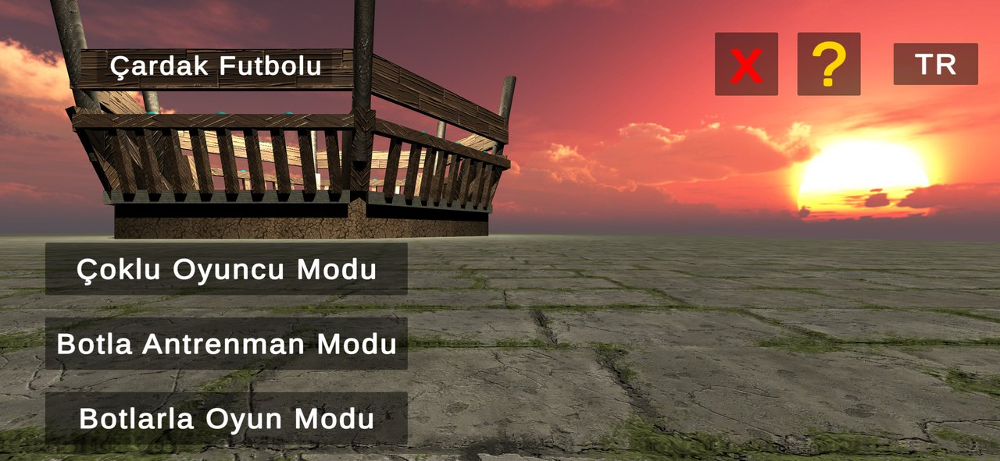
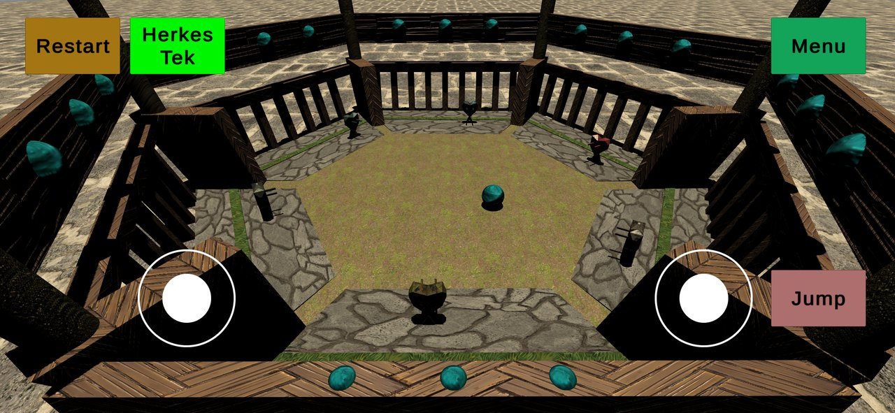
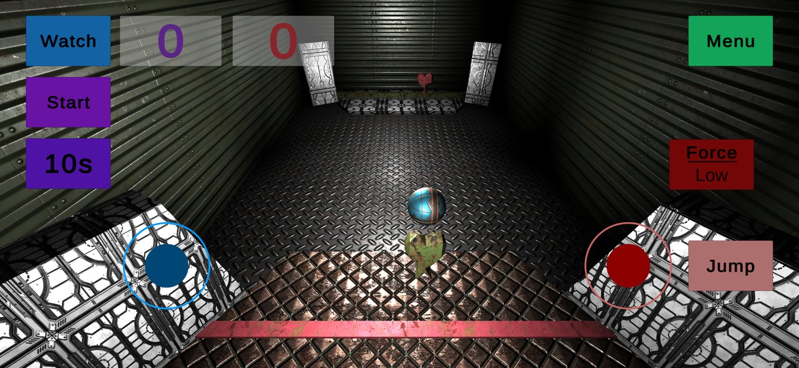
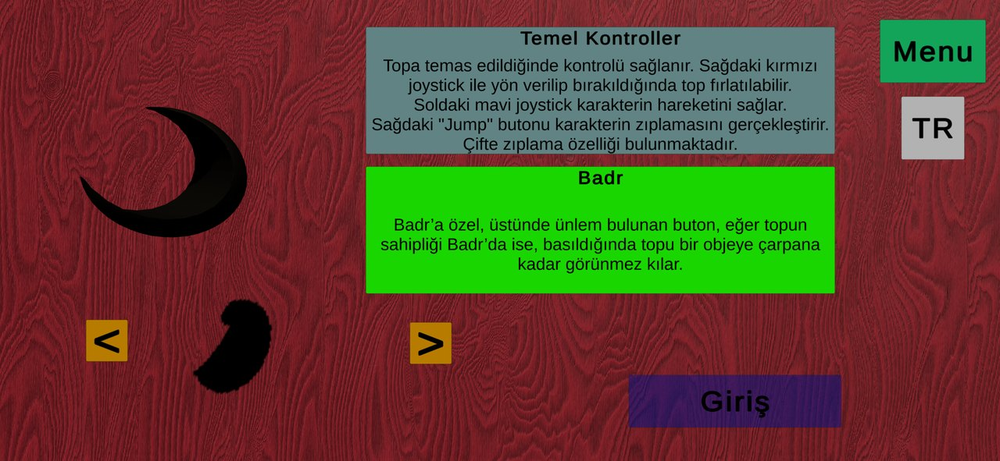
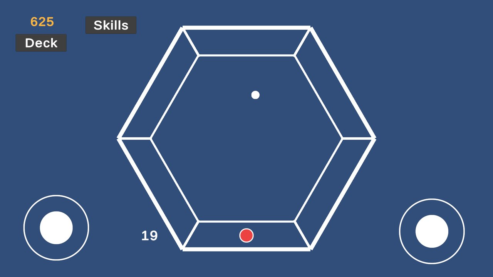

# Gazebo Soccer (Çardak Futbolu)

**Graduation project** · 09/2024 – 01/2025 · Unity · C# · Photon Fusion 2 · ML-Agents · ProBuilder

A competitive, gazebo-themed soccer game that can be played online and offline. The field is a hexagon and every player defends their own goal. The repository holds two Unity projects of the same idea:

| Folder | Version |
|---|---|
| [`GazeboSoccer3D/`](GazeboSoccer3D) | 3D game: online matches, ML-Agents bots, 6 characters with their own abilities |
| [`HexBall2D/`](HexBall2D) | 2D version (HexBall): online hexagonal arena with a skill deck |

> More of my projects: **[burak-unye.vercel.app](https://burak-unye.vercel.app)**

## 3D version

| Main menu | Playing against bots |
|:---:|:---:|
|  |  |
| **1v1 training with an ML-Agents bot** | **Character selection** |
|  |  |

- **Online multiplayer** with Photon Fusion 2: host/client sessions, player spawning and networked ball possession (`Scripts/Spawner.cs`, `Scripts/PlayerAndBall/`).
- **Offline modes:** *Bot Training* (1v1 against a trained agent) and *Play with Bots* (everyone against bots).
- **ML-Agents:** goalkeeper and player agents trained with Unity ML-Agents (`Scripts/MLAgents/`, `Scripts/1V1/`). Trained models (`.onnx`) and recorded demonstrations are in `Assets/Brains`; `MLAgentsTraining.unity` is the training scene.
- **6 characters** with different abilities, such as a shield, a push, earth blocks and an invisible ball (`Scripts/Skills*`, `Scripts/SilentBall/`).
- Mobile controls with two joysticks and a jump button; arena built with ProBuilder; Turkish/English menu.

## 2D version (HexBall)

- Online hexagonal arena built on Photon Fusion 2 (`AutoHostOrClient` rooms) with **host migration**: if the host leaves, the game continues on a new host from a snapshot (`Scripts/Network/NetworkBootstrap.cs`).
- **30+ skills** (power shot, magnet, curse, mirror, soul swap, telekinesis…) that players add to their deck (`Scripts/Skills`, `Scripts/Core/PlayerDeck.cs`).
- Arena layout, keepers, discs and ball are generated in code (`Scripts/Core/HexArena.cs`, `ArenaLayout.cs`).

## Opening the projects

Unity **6000.0.58f2**. Open `GazeboSoccer3D` or `HexBall2D` as a project in Unity Hub.

To keep the repository small and to respect asset licences, third-party packages are **not included**. Import them before opening the scenes:

| Package | Needed for |
|---|---|
| Photon Fusion 2 SDK (Photon Engine) — then set your own App ID in `PhotonAppSettings` | both |
| Joystick Pack (Fenerax Studios, free on the Asset Store) | both |
| Environment art: KoreanTraditional Smart Materials, Free HDR Skyboxes Pack, Ground Textures Pack, LowlyPoly, Stylized Wood Textures, Yughues Free Metal Materials, Kamgam | 3D (without them some materials show as missing) |

ML-Agents and ProBuilder come from the Package Manager automatically. Music files are not included.

---

## Türkçe

Bitirme projem. Online ve offline oynanabilen, çardak temalı rekabetçi futbol oyunu; altıgen sahada her oyuncu kendi kalesini korur. 3D sürümde Photon Fusion 2 ile online maç, ML-Agents ile eğitilmiş botlar ve farklı yeteneklere sahip 6 karakter var. 2D sürüm (HexBall) aynı fikrin online altıgen arena hali: host değişimi ve 30'dan fazla yetenekten oluşan deste sistemi.

Repoda kendi kodum, sahnelerim, prefab'larım ve eğitilmiş modeller var. Asset Store paketleri (Photon SDK, Joystick Pack, doku ve model paketleri) lisans ve boyut nedeniyle eklenmedi; açmadan önce yukarıdaki tabloda yazanları içe aktarın.
